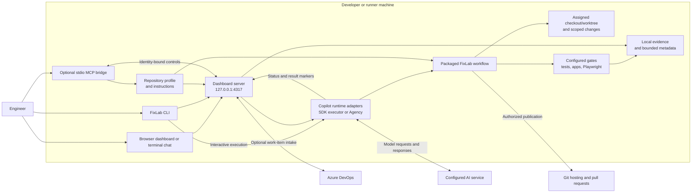
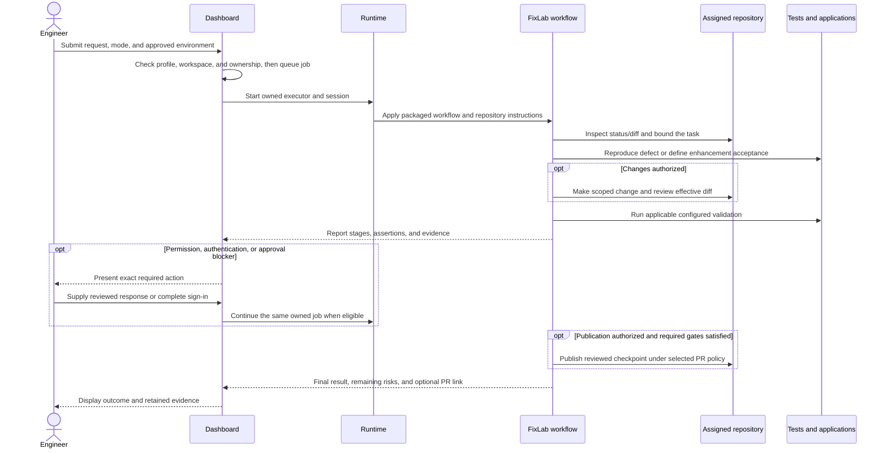

<p align="center">
  
</p>

<h1 align="center">FixLab</h1>

<p align="center">
  From a bug or small enhancement to a tested, evidence-backed pull request.
</p>

FixLab coordinates repository-aware diagnosis, scoped code changes, focused
tests, and Playwright validation through **Agency Copilot** or **GitHub Copilot**.
It supports React/.NET applications and backend-only API validation.
Application-specific paths, commands, environments, and safety rules stay in
the application's repository-owned profile.

## Get started

Install and authenticate a supported Copilot runtime, then run:

```powershell
npm install --global github:MonaDevAI/FixLab
fixlab chat C:\source\application --runtime copilot
```

Replace the path with your checkout; use `--runtime agency` for Agency.
Guided setup checks readiness before starting the local dashboard. Review the
profile and approve only the required setup, sign-in, and tool operations.
Installing the CLI alone does not start a service or make an application ready.

Prefer Copilot to perform setup? Use the
[copy-paste installation prompt](docs/installation.md#copy-paste-installation-prompt).
For VS Code, follow the
[custom-agent setup](docs/installation.md#install-and-use-in-visual-studio-code).

## What you can do

| Workflow | Outcome |
| --- | --- |
| Fix a bug or small enhancement | Scoped changes, validation evidence, and an authorized pull request |
| Validate an existing change or PR | Findings and evidence without source or PR changes |
| Run focused Playwright validation | Browser or configured API assertions without an implementation job |

## Architecture and benefits

FixLab coordinates the developer-facing dashboard and CLI, a repository-owned
profile, Copilot execution, and configured validation. It runs locally on the
developer or runner machine; the configured AI service supplies model access.

### System architecture



| Component | Responsibility |
| --- | --- |
| CLI, terminal chat, and dashboard | Onboard repositories, submit work, show progress, and collect human decisions |
| Repository profile | Define application paths, commands, environments, validation gates, and safety policy |
| Copilot runtime and FixLab workflow | Investigate the task, make authorized scoped changes, and collect evidence |
| Configured checks | Run focused tests, required application startup, and browser/API validation |
| Evidence and metadata | Retain local results, artifacts, and bounded recovery context |
| Optional MCP bridge | Connect a host conversation to identity-bound dashboard controls |

The dashboard and terminal chat share job state, blockers, and results.
Interrupted work can resume in the same job; a bounded queue keeps later
requests separate.

### End-to-end job flow



Efficient delivery defaults to focused checks and an authorized **draft PR**.
Optional broad tests/builds are controlled by saved preferences; required
repository checks and CI/merge policies still apply. Failed, deferred, stale,
or skipped checks are never reported as passed.

### Benefits

| Benefit | Mechanism |
| --- | --- |
| Repeatable delivery | A shared workflow with repository-owned commands, boundaries, and gates |
| Fewer manual handoffs | Diagnosis, scoped edits, startup, validation, and evidence in one job |
| Reviewable outcomes | Explicit assertions, failures, skipped checks, risks, and PR state |
| Recoverable work | Same-job/session continuation instead of discarding completed work |
| Reuse across applications | Profiles configure applications without hardcoding them into the product |
| Bounded context | Focused searches, compact command evidence, and advisory metadata reuse |

These are workflow capabilities, not guarantees of correctness, cost reduction,
or faster delivery. Actual results depend on repository quality, model/runtime
availability, authentication, and the configured validation contract.

The [architecture and benefits guide](docs/architecture-overview.md) contains
the same diagrams and benefits, plus deployment, state/recovery, and detailed
trust boundaries.

## Documentation

| Start here | Read next |
| --- | --- |
| [Installation](docs/installation.md) | Prerequisites, Copilot prompt, VS Code, updates, and optional integrations |
| [Getting started](docs/getting-started.md) | First job, dashboard use, approvals, and recovery |
| [Architecture and benefits](docs/architecture-overview.md) | Component diagrams, job flow, deployment, and trust boundaries |
| [Repository onboarding](docs/repository-onboarding.md) | Profiles, worktrees, API-only validation, and linked applications |
| [Troubleshooting](docs/troubleshooting.md) | Installation, authentication, runtime, and validation blockers |
| [All documentation](docs/README.md) | Technical references, security, rollout, and contributor guides |

## Execution and safety

FixLab is a **single-user local tool**, not a hosted multi-user broker or
managed runner service. The dashboard binds to `127.0.0.1`; worktrees isolate
changes, not operating-system privileges.

Authentication, sensitive actions, deployment, and publication retain their
approval requirements. Only FixLab-owned processes and artifacts may be
cleaned up. Never put credentials, browser state, private endpoints, or
customer data in prompts, source, logs, or durable caches.
See the [security model](docs/security.md).

Install from GitHub until npm/marketplace publication is available; consult
[GitHub releases](https://github.com/MonaDevAI/FixLab/releases) for published
versions. A default-branch install can contain changes newer than a release.

## Contributing

See [Contributing](CONTRIBUTING.md) for reproducible setup and the required
`npm run validate` completion gate, including the Windows validation runner.
Behavior contracts live in [`specs/v1`](specs/v1); start a repository profile
from [`templates/repository-profile.json`](templates/repository-profile.json).

---

<p align="center">
  Copyright &copy; 2026 FixLab Contributors. All rights reserved.<br>
  Released under the <a href="LICENSE">MIT License</a>.
</p>
