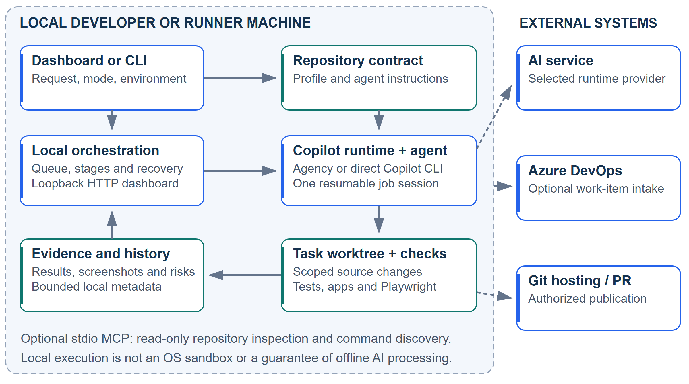
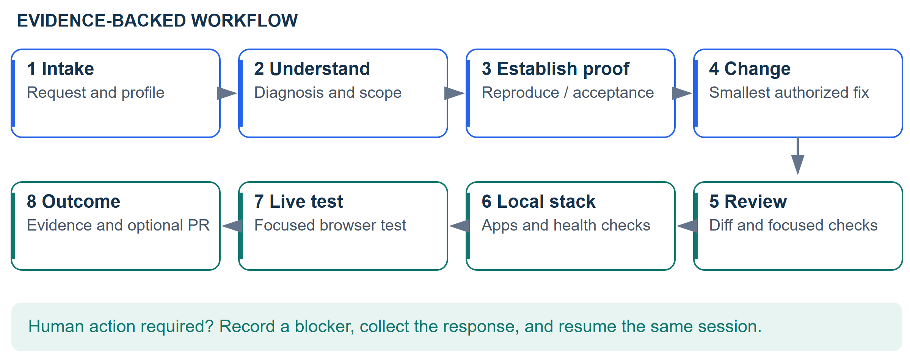

<p align="center">
  
</p>

<h1 align="center">FixLab</h1>

<p align="center">
  From a bug or small enhancement to a tested, evidence-backed pull request.
</p>

FixLab coordinates repository-aware diagnosis, scoped code changes, focused
tests, and Playwright validation through **Agency Copilot** or **GitHub Copilot**.
It supports React/.NET applications and backend-only API validation.
Application-specific paths, commands, environments, and safety rules stay in
the application's repository-owned profile.

## Get started

Install and sign in to a supported Copilot runtime, open the application
checkout, and paste:

```text
Install or reuse FixLab, register its MCP server, and onboard this repository
with --runtime copilot. Follow FIXLAB-SETUP.md if supplied; otherwise use:
https://github.com/microsoft/FixLab/blob/main/docs/installation.md
Review the real profile and setup plan with me before each change.
Ask me for missing setup details; do not guess paths or settings.
Use Microsoft Edge by default for required browser validation. Review feed
access, dedicated browser SSO and private-state protection; run Doctor.
Ask before starting or reusing the matching dashboard. I will complete MFA.
Preserve my code and running services. Do not start a job or publish changes.
```

For reusable instructions, copy or attach [FIXLAB-SETUP.md](docs/FIXLAB-SETUP.md)
without overwriting an existing guide. If Copilot or the file is unavailable,
use [installation.md](installation.md) and the
[detailed manual steps](docs/installation.md). Download the
[Word quickstart](docs/FixLab-Installation-Guide-Quickstart.docx) or follow the
[VS Code guide](docs/installation.md#install-and-use-in-visual-studio-code).
Setup still requires reviewed approvals; installing FixLab alone does not
establish application readiness or grant permissions.

## What you can do

| Workflow | Outcome |
| --- | --- |
| Fix a bug or small enhancement | Scoped changes, validation evidence, and an authorized pull request |
| Validate an existing change or PR | Findings and evidence without source or PR changes |
| Run focused Playwright validation | Browser or configured API assertions without an implementation job |

## Architecture and benefits

FixLab coordinates the developer-facing dashboard and CLI, a repository-owned
profile, Copilot execution, and configured validation. It runs locally on the
developer or runner machine; the configured AI service supplies model access.

### System architecture



The dashboard and terminal chat share job state, blockers, and results.
Interrupted work can resume in the same job; a bounded queue keeps later
requests separate.
During the existing PR step, verified reusable learning is captured in a
reviewed repository skill (`.github/skills/<topic>/SKILL.md`), updating a
matching skill rather than duplicating it. No extra roadmap stage is added.
If there is no new reusable learning, the PR says so instead of adding a file.

### End-to-end job flow



Efficient delivery defaults to focused checks and an authorized **draft PR**.
Optional broad tests/builds are controlled by saved preferences; required
repository checks and CI/merge policies still apply. Failed, deferred, stale,
or skipped checks are never reported as passed.

See [architecture and benefits](docs/architecture-overview.md) for components,
benefits, deployment, recovery, and trust boundaries, or the
[architecture reference](docs/architecture.md) for runtime and MCP contracts.

## Work in the dashboard

After setup, ask Copilot:

> Start or reuse this repository's FixLab dashboard with `--runtime copilot`
> and show me its local URL. Ask me if any setup details are missing.
> Do not start a job.

Or start it manually and open the printed local URL:

```powershell
fixlab dashboard C:\source\application --port 4317 --runtime copilot
```

Follow the [dashboard user guide](docs/getting-started.md) to submit a request,
choose run options, handle approvals, review evidence, and resume saved work.

### Stop or replace an unused dashboard

At `fixlab>`, `/stop` stops the job and leaves it resumable; `/exit` disconnects
chat without stopping the dashboard. Press **Ctrl+C in the dashboard's
terminal** to stop the server and release its port.

If Copilot started it in the background, ask:

> Shut down FixLab on port 4317 and only its owned processes. Leave other
> applications running.

Start a replacement using the available port:

```powershell
fixlab dashboard C:\source\application --port 4317 --runtime copilot
```

Optionally, in another terminal, connect chat to that same port:

```powershell
fixlab chat C:\source\application --port 4317 --runtime copilot
```

Closing a browser tab or exiting Copilot does not stop a detached dashboard.
No reinstall or file deletion is needed. Restarting preserves saved jobs;
submit a new request for a fresh job.

## Documentation

| Start here | Read next |
| --- | --- |
| [First installation](installation.md) | Prerequisites, machine changes, and reviewed setup |
| [Detailed installation](docs/installation.md) | Copilot prompt, VS Code, updates, and optional integrations |
| [Dashboard user guide](docs/getting-started.md) | Startup, requests, approvals, evidence, recovery, and shutdown |
| [Architecture and benefits](docs/architecture-overview.md) | Component diagrams, job flow, deployment, and trust boundaries |
| [Repository onboarding](docs/repository-onboarding.md) | Profiles, worktrees, API-only validation, and linked applications |
| [Troubleshooting](docs/troubleshooting.md) | Installation, authentication, runtime, and validation blockers |
| [All documentation](docs/README.md) | Technical references, security, rollout, and contributor guides |

## Execution and safety

FixLab is a **single-user local tool**, not a hosted multi-user broker or
managed runner service. The dashboard binds to `127.0.0.1`; worktrees isolate
changes, not operating-system privileges.

Authentication, sensitive actions, deployment, and publication retain their
approval requirements. Only FixLab-owned processes and artifacts may be
cleaned up. Never put credentials, browser state, private endpoints, or
customer data in prompts, source, logs, or durable caches.
See the [security model](docs/security.md).

Install from GitHub until npm/marketplace publication is available; consult
[GitHub releases](https://github.com/microsoft/FixLab/releases) for published
versions. A default-branch install can contain changes newer than a release.

## Contributing

See [Contributing](CONTRIBUTING.md) for reproducible setup and the required
`npm run validate` completion gate, including the Windows validation runner.
Behavior contracts live in [`specs/v1`](specs/v1); start a repository profile
from [`templates/repository-profile.json`](templates/repository-profile.json).

---

<p align="center">
  Copyright &copy; 2026 FixLab Contributors. All rights reserved.<br>
  Released under the <a href="LICENSE">MIT License</a>.
</p>
