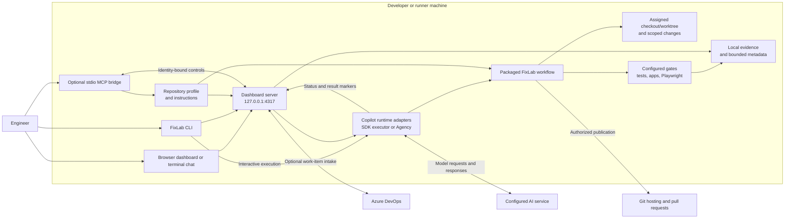

# FixLab architecture and benefits

## Purpose and scope

FixLab turns a defect, small enhancement, or existing pull request into an
evidence-backed engineering outcome. It coordinates scoped changes through
Copilot, repository-owned validation, application startup when needed, and
review evidence.

React/.NET applications and backend-only APIs are supported through profiles.
They are applications under test, not the FixLab dashboard stack. Paths,
commands, environments, authentication requirements, and validation policy
belong to each application repository.

This overview describes the current local implementation. The
[architecture reference](architecture.md) contains detailed operational
contracts. A hosted team broker and managed runner service are future
deployment concepts, not shipped services.

## System context and components



Direct interactive CLI execution does not require the dashboard. Dashboard
jobs use owned runtime executors: the official Copilot SDK and its bundled
runtime in direct mode, or Agency in compatibility mode. FixLab does not fork
the selected runtime or replace its managed policies.

| Component | Responsibility | Implementation |
| --- | --- | --- |
| CLI | Install-time help, onboarding, readiness, jobs, chat, and dashboard startup | [bin/fixlab.js](../bin/fixlab.js) |
| Dashboard | Local queue, lifecycle, runtime requests, gate state, and evidence UI | [dashboard](../dashboard) |
| Intake | Manual requests, bounded screenshots, and optional Azure DevOps loading | [dashboard/intake.js](../dashboard/intake.js) |
| Runtime adapters | Contained execution, session continuity, and permission/question delivery | [dashboard/server.js](../dashboard/server.js) |
| FixLab workflow | Scope the task, implement authorized changes, validate, and report outcomes | [agents/fixlab.md](../agents/fixlab.md) |
| Repository profile | Supply application-specific paths, commands, gates, and safety policy | [templates/repository-profile.json](../templates/repository-profile.json) |
| MCP bridge | Inspect profiles and connect a host conversation to existing dashboard controls | [mcp/server.js](../mcp/server.js) |

The MCP bridge is not a separate scheduler or authorization service. It checks
dashboard/repository/job identity and retains normal approval and safety gates.

## End-to-end job flow

```mermaid
sequenceDiagram
    actor Engineer
    participant Dashboard
    participant Runtime
    participant Agent as FixLab workflow
    participant Repo as Assigned repository
    participant Checks as Tests and applications

    Engineer->>Dashboard: Submit request, mode, and approved environment
    Dashboard->>Dashboard: Check profile, workspace, and ownership; queue job
    Dashboard->>Runtime: Start owned executor and session
    Runtime->>Agent: Apply packaged workflow and repository instructions
    Agent->>Repo: Inspect status/diff and bound the task
    Agent->>Checks: Reproduce defect or define enhancement acceptance
    opt Changes authorized
        Agent->>Repo: Make scoped change and review effective diff
    end
    Agent->>Checks: Run applicable configured validation
    Agent-->>Dashboard: Report stages, assertions, and evidence
    opt Permission, authentication, or approval blocker
        Dashboard-->>Engineer: Present exact required action
        Engineer->>Dashboard: Supply reviewed response or complete sign-in
        Dashboard->>Runtime: Continue the same owned job when eligible
    end
    opt Publication authorized and required gates satisfied
        Agent->>Repo: Publish reviewed checkpoint under selected PR policy
    end
    Agent-->>Dashboard: Final result, remaining risks, and optional PR link
    Dashboard-->>Engineer: Display outcome and retained evidence
```

Stages distinguish `passed`, `failed`, `blocked`, and `skipped`. A skipped,
timed-out, deferred, or stale check is not a pass. Efficient delivery can
publish an authorized draft checkpoint before optional independent validation;
required gates, strict policy, and CI/merge protections remain authoritative.

| Mode | Allowed outcome |
| --- | --- |
| Fix and validate | A scoped bug fix or enhancement, configured checks, and authorized publication |
| Validate only | Findings and evidence without edits, commits, pushes, or PR updates |
| Playwright validation only | Focused browser/API assertions and required setup, without implementation or PR work |

API-only profiles use Playwright `APIRequestContext` without a browser.
Explicit unit-only profiles defer live testing with a recorded reason; their
unit results cannot be presented as integration proof. Browser scenarios
distinguish real-backend evidence from synthetic or intercepted checks.

Structured `FIXLAB_STAGE`, `FIXLAB_BUG`, `FIXLAB_TEST`, and `FIXLAB_ACTIVITY`
output supplies operational status and concise activity, not hidden model
reasoning. Dashboard-owned gates require actual executor results; an agent
marker alone cannot pass them.

## Why use FixLab?

| Benefit | Mechanism |
| --- | --- |
| Repeatable delivery | A shared workflow with repository-owned commands, boundaries, and gates |
| Fewer manual handoffs | Diagnosis, scoped edits, startup, validation, and evidence in one job |
| Reviewable outcomes | Explicit assertions, failures, skipped checks, risks, and PR state |
| Recoverable work | Same-job/session continuation instead of discarding completed work |
| Reuse across applications | Profiles configure applications without hardcoding them into the product |
| Bounded context | Focused searches, compact command evidence, and advisory metadata reuse |

These are workflow capabilities, not guarantees of correctness, cost reduction,
or faster delivery. Actual results depend on repository quality, model/runtime
availability, authentication, and the configured validation contract.

## Deployment, state, and recovery

The package runs as a single-user local process. Installation does not start
a service; `fixlab dashboard` or a ready `fixlab chat` connection starts the
loopback dashboard. No hosted broker, shared database, or cloud deployment is
required.

There is one active executor, up to 20 pending jobs, and a separate held-job
collection. A canonical repository lease prevents conflicting executors,
including across linked worktrees. Blocked/failed work pauses the queue;
explicit hold or dismissal uses the normal lifecycle controls.

| State or evidence | Location and purpose |
| --- | --- |
| Task changes | Assigned checkout/worktree under the reviewed workspace policy |
| Active execution | In-memory queue, bounded logs, pending runtime requests, and owned processes |
| Recent jobs | Shared Git directory: `fixlab/dashboard-jobs.json`; bounded private summaries and recovery context |
| Advisory memory | Shared Git directory: `fixlab/dashboard-cache.json`; bounded sanitized metadata |
| Metrics | Shared Git directory: `fixlab/dashboard-metrics.json`; bounded numeric usage and timing |
| Command evidence | Worktree Git-private `fixlab/command-evidence`; redacted output and result records |
| Browser evidence | Repository-owned `test-results`, `playwright-report`, or `artifacts` roots |

Git-directory paths are logical: linked worktrees use Git's resolved common
directory where required, not an assumed `.git` folder. Runtime session
storage and raw evidence are separate from the metadata cache.

Memory cannot pass a gate. Source/profile/instruction changes invalidate reuse,
and recovered gate evidence must satisfy freshness checks. An interrupted
executor is not assumed to be running after restart; unverified termination
remains blocked rather than authorizing automatic takeover.

## Trust and safety boundaries

- Keep the dashboard on loopback. It is not an authenticated multi-user server.
- Worktrees isolate changes, not OS privileges. Commands run with the local
  user's permissions; FixLab is not a sandbox.
- Direct Copilot jobs expose native permission/question review. Scoped trust
  and privileged per-run options require their own explicit approval and do
  not override managed policy.
- Authentication, unsafe data access, deployment, and publication retain
  their separate controls. Never infer production permission from a local pass.
- Stop only tracked owned processes. Artifact serving and cleanup stay inside
  verified roots and reject paths escaping through links.
- Do not put credentials, cookies, browser state, customer data, or
  authorization headers in prompts, source, logs, or durable caches.
- Selected context can pass through the AI runtime to its configured provider.
  Local execution is not a promise of offline model processing.

Azure DevOps intake confines its access token to outbound authorization headers.
MCP cannot complete MFA, transfer another session's permissions, or approve
unsafe actions by ordinary conversation replies. See the [security model](security.md).

## Current package versus a future team service

| Concern | Current package | Additional team-service design needed |
| --- | --- | --- |
| Access | Single-user loopback dashboard | Organizational authentication and authorization |
| Scheduling | Local queue and repository ownership lease | Durable broker, concurrency policy, and runner assignment |
| Execution | Owned local runtime and repository tools | Managed runner registration, isolation, and lifecycle |
| Evidence | Local artifacts and bounded Git-private metadata | Governed shared storage, tenant isolation, and retention |
| Operations | Local logs, stage outcomes, and metrics | Central monitoring, audit, and availability ownership |

These are extension points, not shipped hosted capabilities. Continue with
[Getting started](getting-started.md), the [architecture reference](architecture.md),
or the [team rollout guide](team-rollout.md).
